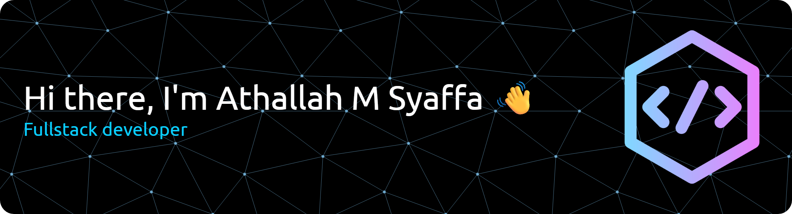

# 👋 Hi, I'm Athallah Muhammad Syaffa

💻 **Junior Fullstack Developer** — Laravel, CodeIgniter & React on the web, Flutter on mobile.
🛠️ I build software that real people actually use: an AI customer-service bot taking flower orders on WhatsApp, an e-commerce site running my mom's herbal drink business, and a farm-management app my dad uses every day.
🎯 **Currently:** IT Staff at a florist business in Banjarbaru, while studying Software Engineering (D4 TRPL) at Politeknik IDN Bogor, semester 5.

---

## 🚀 Tech Stack

### **Frontend**

  
  
  
  
  
  
  
  

### **Backend & Database**

  
  
  
  
  

### **AI & Integrations**

  
  

### **Mobile**

  
  

### **Tools & Development**

  
  
  
  
  
  

### **Currently Learning**

  
  

---

## 📌 Featured Projects

### 🔹 WhatsApp AI Customer Service & Ordering Bot — Florist Business
Customers message a flower shop at night, when no staff are online. I built a bot that answers and takes orders on WhatsApp between 22:00 and 08:00: it understands free-text requests with Gemini, quotes shipping by distance, creates the order, and checks payment proofs. When a staff member replies from the shop's phone, the bot goes quiet for that customer automatically, and staff can also take over any chat from an admin dashboard.
**Result:** it is live in production and has taken real customer orders overnight, without staff online.
**Stack:** CodeIgniter 4 · Gemini API · WhatsApp Business API (webhooks, HMAC signature check) · MySQL · PHPUnit

### 🔹 [Herbal Qaf — E-commerce for a Family Business](https://herbal-qaf.vercel.app/)
My mom used to take orders through scattered WhatsApp chats. I built her a storefront that handles the whole flow instead: pick a product, enter an address, get shipping cost automatically via the RajaOngkir API, then send a pre-filled order straight to WhatsApp.
**Result:** what took ~10 back-and-forth messages now takes one click.
**Stack:** Next.js · Tailwind CSS · Framer Motion · RajaOngkir API

### 🔹 [AyamKu — Farm Management App](https://github.com/athallahsy)
My dad ran his chicken farm on handwritten notes. I built him an Android app instead: it auto-calculates feed and water needs by growth phase, tracks income and expenses across up to 3 coops, and estimates profit per harvest — with a large-text, minimal UI designed for a non-technical user.
**Stack:** Flutter · Dart · Hive · Provider · fl_chart

### 🔹 [Finote — Personal Finance Manager](https://github.com/athallahsy/finote)
An API-first finance tracker: transaction recording, categories, and monthly reports, secured with Laravel Sanctum, plus a full admin panel in Filament and PDF export for reports.
**Stack:** Laravel 12 · Sanctum · Filament · MySQL · REST API

### 🔹 [Muhayya Fair 2025 — Event Landing Page](https://muhayya-fair.vercel.app/)
A freelance job with a real deadline: an animated landing page for a school event, live before the event started and used on the day.
**Stack:** HTML · CSS · Bootstrap · AOS

### 🔹 [Inkwell — Blog CMS](https://github.com/athallahsy/inkwell)
A full-stack blog platform with role-based access control, article and category management, a file manager, and CSRF-protected authentication middleware.
**Stack:** Laravel · Breeze · MySQL · Blade

### 🔹 [Portfolio Website](https://athallahsy.vercel.app)
My personal site — built to load fast, look sharp on mobile, and actually show the projects above instead of just listing them.
**Stack:** React.js · Tailwind CSS · Three.js · GSAP

---

## 🎯 What I'm Working On
- 📱 Building a guest-checkout Android app (Flutter) on top of an existing REST API for a two-store florist business
- 🔨 Shipping more full-stack projects that solve a real problem for a real person, not just tutorial clones
- 📚 Learning **Node.js** and **Express.js** for backend diversity
- 🚀 Exploring **Next.js** patterns beyond what I've already shipped with Herbal Qaf
- 📱 Extending my Flutter skills toward **React Native**

---

## 💡 A Bit More About Me
- 📖 I'm a Hafiz of the Quran (30 Juz) — memorizing it taught me patience and discipline long before I wrote my first line of code, and it still shows in how I debug.
- 🌅 Best coding hours: morning, one cup of coffee in.
- 🎯 My approach: build for the person who'll actually use it — whether that's an admin managing data through Filament, or my dad checking his coop's numbers on his phone.

---

## 📫 Let's Connect

  
  
  
  

---

### ✨ *"Code with passion, debug with patience."* ✨
Open to full-time roles, freelance work, and remote collaboration.

⭐️ From [Athallah Muhammad Syaffa](https://github.com/athallahsy)

